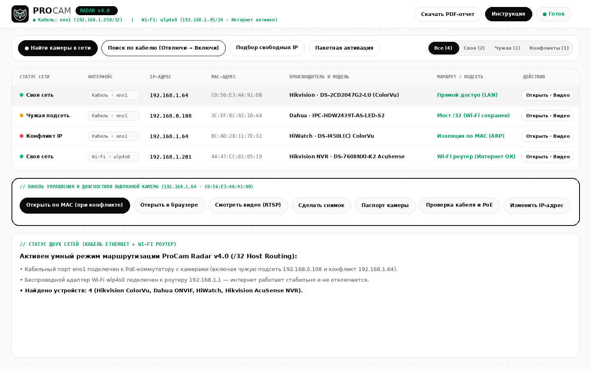
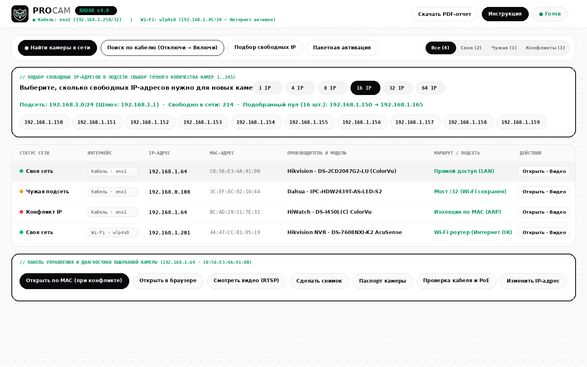
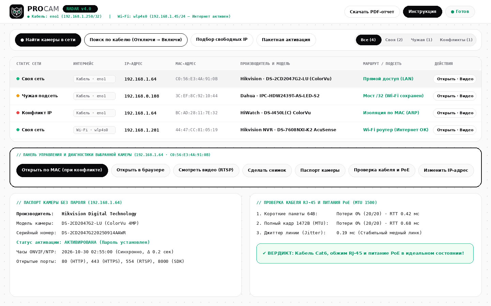

<div align="center">
  
  <h1>ProCam Radar v4.0 — Engineering Suite</h1>
  <p><b>Графический инженерный комплекс поиска, диагностики и настройки IP-камер Hikvision, HiWatch, Dahua и ONVIF (Windows & Linux)</b></p>

  <p>
    <a href="https://github.com/Yeeerniyaz/procam-radar/releases/latest/download/ProCamRadar_Windows_x64.exe">
      
    </a>
    <a href="https://github.com/Yeeerniyaz/procam-radar/releases/latest/download/ProCamRadar_Linux_x64">
      
    </a>
    <a href="PROCAM_RADAR_MANUAL_RU.pdf">
      
    </a>
  </p>
</div>

---

## 📸 Скриншоты графического приложения

### 1. Главный экран: одновременная работа Кабеля и Wi-Fi без обрыва интернета (`/32`)


### 2. Подбор свободных IP-адресов с выбором нужного количества камер (`1..245`)


### 3. Беспарольный паспорт камеры и стресс-тест кабеля RJ-45 / PoE (`MTU 1500`)


---

## ⚡ Ключевые возможности ProCam Radar v4.0

1. **Две сети одновременно (Кабель Ethernet + Wi-Fi роутер без потери интернета):**
   При подключении ноутбука кабелем к PoE-коммутатору с камерами и одновременно по Wi-Fi к роутеру, программа создает точечные маршруты `/32` до камер через кабель, не разрывая интернет по Wi-Fi.
2. **Подбор свободных IP с выбором количества (`1..245` адресов):**
   Выберите, сколько камер нужно установить (`1`, `4`, `8`, `16`, `32`, `64` или любое число вручную) — программа проверит все 254 адреса подсети (ARP + ICMP + TCP) и выдаст готовый пул свободных IP.
3. **Открыть по MAC (при конфликте IP) без отключения кабелей:**
   Если несколько новых камер висят на одном заводском IP (`192.168.1.64` или `192.168.1.108`), выберите нужную камеру в таблице и нажмите **«Открыть по MAC (при конфликте)»**.
4. **Поиск по кабелю («Отключи → Включи»):**
   Отключите патч-корд искомой камеры на 3 секунды и включите обратно — программа перехватит пакет инициализации камеры и автоматически откроет к ней доступ.
5. **Паспорт камеры и Проверка кабеля RJ-45 / PoE:**
   Опрос серийного номера, статуса активации и точности часов ONVIF без пароля, а также сравнение прохождения пакетов `64B` и тяжелых кадров `1472B (MTU 1500)` для выявления плохого обжима RJ-45.
6. **Инженерный PDF-паспорт объекта:**
   Генерация чистого отчета в формате PDF с логотипом ProCam, таблицей всех камер (IP, MAC, модель, серийный номер, порты) и стоп-кадрами.

---

## 💻 Установка и запуск

### Windows 10 / 11 (x64)
Установка не требуется (Portable `.exe` со встроенной иконкой Кибер-Совы):
1. Скачайте [**ProCamRadar_Windows_x64.exe**](https://github.com/Yeeerniyaz/procam-radar/releases/latest/download/ProCamRadar_Windows_x64.exe).
2. Запустите файл (для проброса маршрутов в чужие подсети рекомендуется запуск от имени Администратора).

---

### Linux (Ubuntu / Debian / Arch / Mint — x64)

#### Вариант 1: Автоматическая установка одной командой (с иконкой в меню приложений)
Выполните в терминале:
```bash
curl -fsSL https://raw.githubusercontent.com/Yeeerniyaz/procam-radar/main/dist/linux/install.sh | sudo bash
```
Что делает установщик:
* Устанавливает графическую программу `/usr/local/bin/procam-radar-gui` и ядро `/usr/local/bin/procam-radar`.
* Устанавливает фирменную иконку Кибер-Совы в `/usr/share/pixmaps/procam-radar.png` и `/usr/share/icons/hicolor/scalable/apps/procam-radar.svg`.
* Создает ярлык **ProCam Radar** в системном меню приложений (`/usr/share/applications/procam-radar.desktop`).

#### Вариант 2: Установка из склонированного репозитория Git
```bash
git clone https://github.com/Yeeerniyaz/procam-radar.git
cd procam-radar
sudo bash dist/linux/install.sh
```

#### Вариант 3: Портативный запуск без установки
```bash
wget https://github.com/Yeeerniyaz/procam-radar/releases/latest/download/ProCamRadar_Linux_x64
chmod +x ProCamRadar_Linux_x64
./ProCamRadar_Linux_x64
```

---

## 📞 Проектирование, поставка камер и монтаж в Алматы — ProCam
Разработано инженерной командой **ProCam** (Алматы):
* **Оборудование:** Камеры и видеорегистраторы NVR **Hikvision**, **HiWatch**, **Dahua (ONVIF)**.
* **Телефон / WhatsApp:** [+7 (706) 606-63-23](https://wa.me/77066066323) · `+7 (776) 606-63-23`
* **Полная PDF-инструкция:** [PROCAM_RADAR_MANUAL_RU.pdf](PROCAM_RADAR_MANUAL_RU.pdf)
