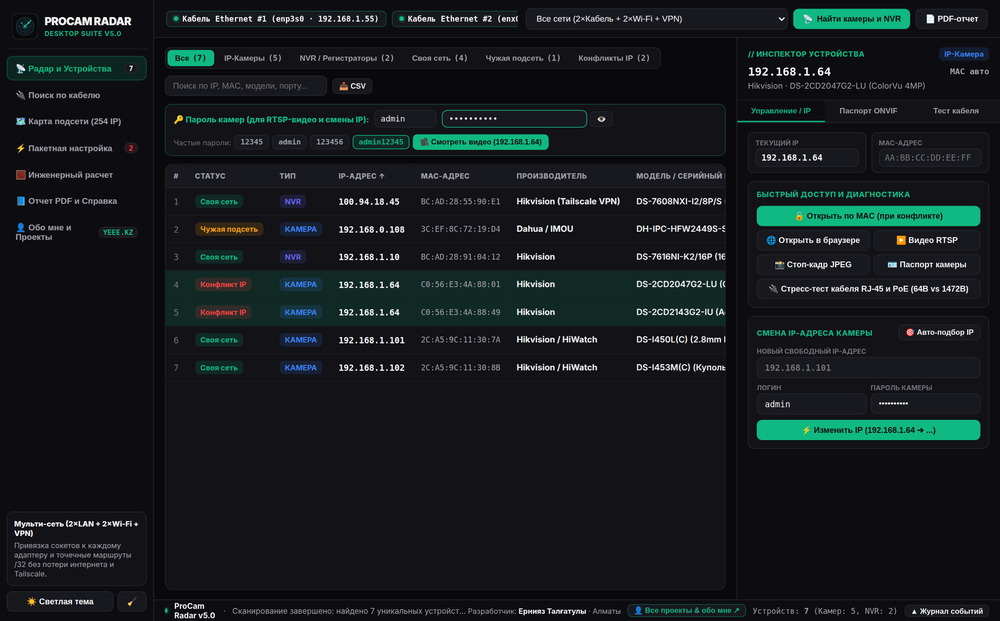
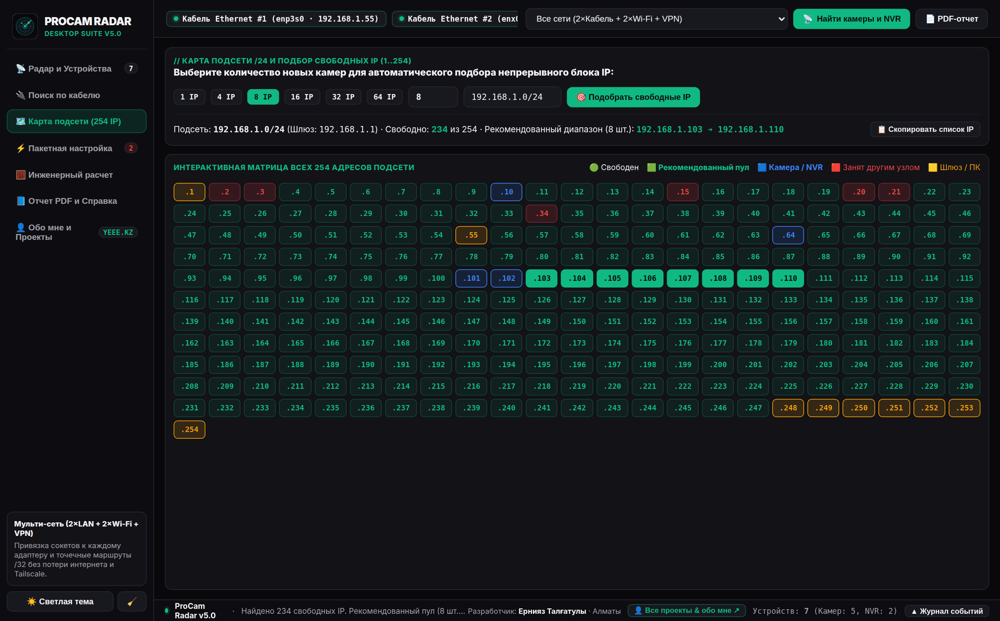
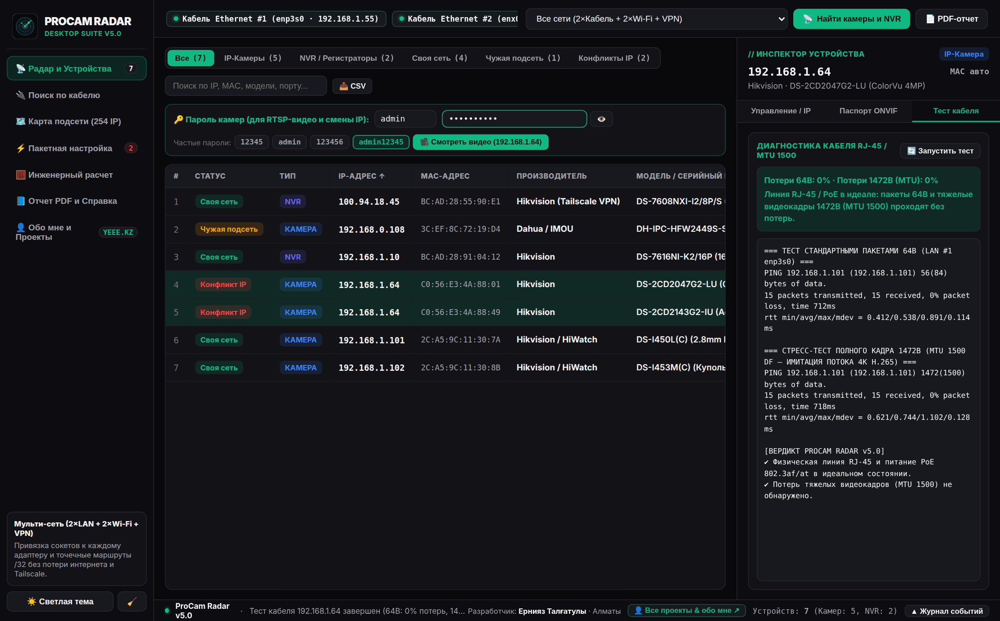
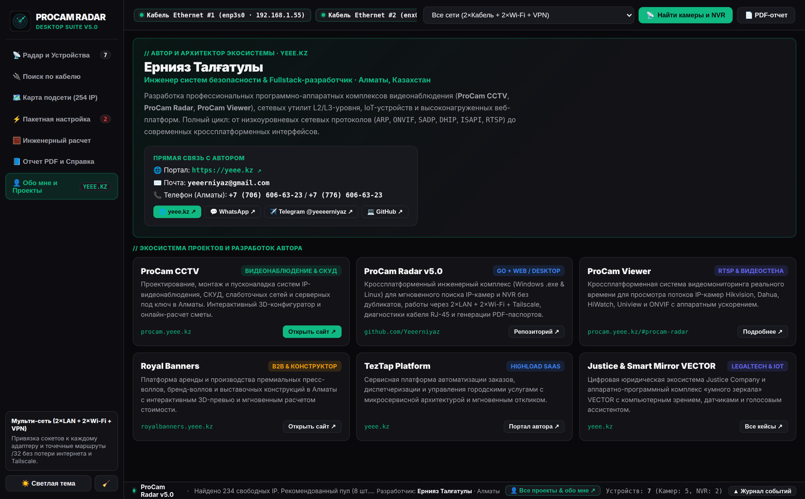

<div align="center">
  
  <h1>ProCam Radar v5.0 — Desktop Engineering Suite</h1>
  <p><b>Нативный графический инженерный комплекс поиска, диагностики и настройки IP-камер и видеорегистраторов NVR Hikvision, HiWatch, Dahua, Uniview и ONVIF (Windows .exe & Linux)</b></p>

  <p>
    <a href="https://github.com/Yeeerniyaz/procam-radar/releases/latest/download/ProCamRadar_Windows_x64.exe">
      
    </a>
    <a href="https://github.com/Yeeerniyaz/procam-radar/releases/latest/download/ProCamRadar_Linux_x64">
      
    </a>
    <a href="PROCAM_RADAR_MANUAL_RU.pdf">
      
    </a>
  </p>
</div>

---

## 📸 Скриншоты нативного приложения ProCam Radar v5.0

### 1. Главный экран: дедупликация устройств (IP + MAC), панель паролей камер для RTSP и мульти-сеть (`2×LAN + 2×Wi-Fi + Tailscale VPN`)


### 2. Интерактивная матрица всех 254 адресов подсети (`/24`) и подбор свободных IP (`1..245`)


### 3. Беспарольный паспорт камеры и стресс-тест кабеля RJ-45 / PoE (`64B` vs `1472B MTU 1500`)


### 4. Авторский раздел и экосистема проектов (`YEEE.KZ`)


---

## ⚡ Ключевые возможности ProCam Radar v5.0

1. **Строгая дедупликация камер и NVR без дубликатов (`IP + MAC`):**
   Ответы `ONVIF WS-Discovery`, `Hikvision SADP`, `Dahua DHIP`, `TCP-сканера` и системной таблицы `ARP` автоматически объединяются в единую запись для каждого физического устройства с числовой сортировкой по IP-адресу.
2. **Мульти-сеть одновременно (`2× Кабеля Ethernet + 2× Wi-Fi + VPN / Tailscale`):**
   Программа привязывает мультикаст-сокеты (`SO_BINDTODEVICE`) к каждому физическому интерфейсу по отдельности, опрашивает удаленные узлы `Tailscale / WireGuard / ZeroTier` и создает точечные маршруты `/32` до камер в чужих подсетях без потери интернета по Wi-Fi.
3. **Встроенный RTSP-видеоплеер и панель паролей камер:**
   Удобная панель **«🔑 Пароль камер (для RTSP-видео и смены IP)»** прямо над таблицей и внутри окна видеоплеера (с быстрыми пресетами `12345`, `admin`, `123456`, `admin12345`), просмотр живого потока прямо в окне программы (`MJPEG`) или во внешнем плеере (`FFplay / MPV / VLC`) с поддержкой `Hikvision`, `Dahua` и `ONVIF`.
4. **Интерактивная карта 254 адресов подсети и подбор свободных IP (`1..245`):**
   Проверяет все 254 адреса подсети (`ARP + ICMP + TCP`) и выделяет непрерывный блок свободных IP-адресов для новых камер.
5. **Открыть по MAC (при конфликте IP) и Поиск по кабелю («Отключи → Включи»):**
   Прямой вход в веб-интерфейс конкретной камеры при совпадении заводских адресов (`192.168.1.64` / `192.168.1.108`) через привязку статического ARP, а также мгновенное вычисление неизвестной камеры в пучке кабелей.
6. **Стресс-тест кабеля RJ-45 (`MTU 1500`) и инженерный PDF-паспорт объекта:**
   Сравнение прохождения коротких пакетов `64B` и тяжелых видеокадров `1472B (DF)` для выявления плохого обжима RJ-45 или просадки PoE, а также генерация чистого отчета в формате PDF.

---

## 💻 Установка и запуск

### Windows 10 / 11 (x64)
Установка не требуется (Portable `.exe` со встроенным манифестом и иконкой):
1. Скачайте [**ProCamRadar_Windows_x64.exe**](https://github.com/Yeeerniyaz/procam-radar/releases/latest/download/ProCamRadar_Windows_x64.exe).
2. Запустите файл (для проброса маршрутов `/32` в чужие подсети рекомендуется запуск от имени Администратора).

---

### Linux (Ubuntu / Debian / Arch / Mint — x64)

#### Вариант 1: Автоматическая установка одной командой (с иконкой в меню приложений)
Выполните в терминале:
```bash
curl -fsSL https://raw.githubusercontent.com/Yeeerniyaz/procam-radar/main/dist/linux/install.sh | sudo bash
```

#### Вариант 2: Установка из склонированного репозитория Git
```bash
git clone https://github.com/Yeeerniyaz/procam-radar.git
cd procam-radar
sudo bash dist/linux/install.sh
```

#### Вариант 3: Портативный запуск без установки
```bash
wget https://github.com/Yeeerniyaz/procam-radar/releases/latest/download/ProCamRadar_Linux_x64
chmod +x ProCamRadar_Linux_x64
./ProCamRadar_Linux_x64
```

---

## 👤 Автор и экосистема проектов — Ернияз Талғатулы (`YEEE.KZ`)
* **Автор и архитектор:** **Ернияз Талғатулы** — Инженер систем безопасности & Fullstack-разработчик (Алматы, Казахстан)
* **Персональный портал:** [https://yeee.kz](https://yeee.kz)
* **ProCam CCTV (Видеонаблюдение и СКУД в Алматы):** [https://procam.yeee.kz](https://procam.yeee.kz)
* **Royal Banners:** [https://royalbanners.yeee.kz](https://royalbanners.yeee.kz)
* **Телефон / WhatsApp / Telegram:** [+7 (706) 606-63-23](https://wa.me/77066066323) · `+7 (776) 606-63-23` · [@yeeeerniyaz](https://t.me/yeeeerniyaz) · `yeeerniyaz@gmail.com`
* **Полная PDF-инструкция:** [PROCAM_RADAR_MANUAL_RU.pdf](PROCAM_RADAR_MANUAL_RU.pdf)
